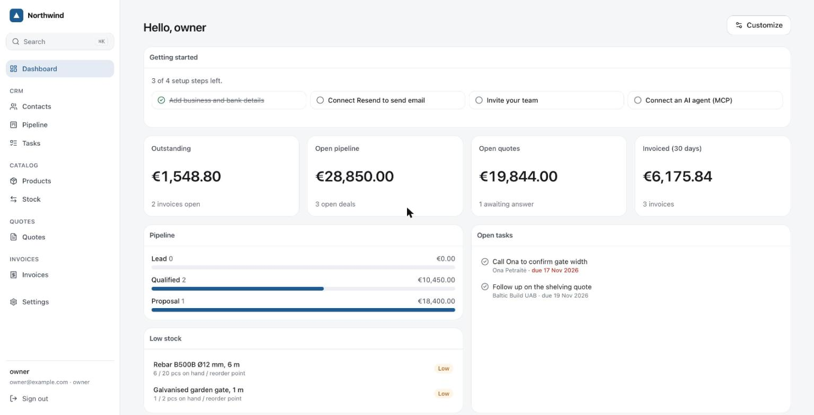

# Sistemėlė

**Don't ask your agent to reinvent the wheel.**

A practical starter kit and admin panel for AI-native projects, on
Cloudflare Workers. Sign-in, roles, audit log, CRM with a leads inbox and your
own pipeline stages, catalog and stock, quotes, invoices, website pages and a
blog, a drag-and-drop dashboard and an MCP endpoint are already built, tested
and documented. Your agent builds only what is specific to the business.

One Worker, one D1 database, MIT licensed. *Sistemėlė* is Lithuanian for "a little system".



```text
Browser ─┬─ /            server-rendered public site (SEO, no client JS)
         ├─ /app/*       React dashboard (drag-and-drop, per-user layouts)
         ├─ /api/*       JSON API (sessions or API tokens, roles, audit)
         └─ /mcp         Model Context Protocol for AI agents
                │
        Cloudflare Worker (Hono) ── D1 (SQLite) · Resend (email) · static assets
```

## Start in two minutes

[](https://deploy.workers.cloudflare.com/?url=https://github.com/aimantas/sistemele)

**Deploy to Cloudflare:** the button copies the code to your GitHub, creates the D1 database, asks for your email (the owner) and a [Resend](https://resend.com) key, and deploys. Every push redeploys.

**Website and live demo:** [sistemele.aimantas.com](https://sistemele.aimantas.com). The site runs on Sistemėlė itself; one click opens the admin panel as the demo owner, with sample data that resets every hour. No email is sent.

**Run it locally** (Node 22+):

```bash
npx degit aimantas/sistemele my-app
cd my-app
npm install
npm run setup        # .dev.vars, local D1 migrations, demo data
npm run dev          # http://localhost:5173 and http://localhost:5173/app
```

Sign in at `/app/login` with `owner@example.com`. Locally, the sign-in link is
shown on screen and printed in the terminal.

## Give your agent the setup

Paste this into Claude Code, Codex, Cursor or any coding agent opened in the project:

```text
Set up Sistemėlė for <business>. Read AGENTS.md first. Run npm run setup,
adapt sistemele.config.ts (modules, locale, currency, business defaults),
switch off the modules we don't need, put our details in
src/worker/site/content.ts, then run npm run check and npm run build.
Ask me before any remote command.
```

What the agent gets:

- [AGENTS.md](AGENTS.md): rules, map, recipes and the definition of done (Claude Code reads it through `CLAUDE.md`).
- A README in every module: tables, API, MCP tools, metrics, widgets, events.
- [docs/extending.md](docs/extending.md): what to reuse and how to add a module without breaking the rules.
- `npm run module:new <id> "<Name>"`, `npm run doctor`, and Claude Code commands: `/new-module`, `/add-widget`, `/add-dashboard-template`, `/add-mcp-tool`, `/seo-check`, `/ship-check`.
- The skill for any skills-compatible agent: `npx skills add aimantas/sistemele`.

Prompts that work:

- "Create a bookings module with services, time slots and a public booking form that creates a lead."
- "Add a dashboard card that shows revenue per month for the last 12 months."
- "Add a pipeline stage 'Site visit' at 40% after Qualified."

## The wheels already here

| Module | |
| --- | --- |
| **CRM** | Leads inbox (new → contacted → qualified, or disqualified with a reason; owners, follow-up dates, sources; one-step conversion into a contact and a deal), contacts, a drag-and-drop pipeline with your own stages and win probabilities, weighted pipeline value, lost reasons, notes, calls, tasks. Website messages arrive as leads. |
| **Catalog & stock** | Products and services, stock ledger with receipts, counts and adjustments, low-stock alerts, public product pages with Product structured data. |
| **Quotes** | Numbered quotes with line items and VAT per rate, a private link where the customer accepts or declines; the deal moves to Won automatically. |
| **Invoices** | Gap-free numbering, immutable once issued, partial payments, overdue tracking, bank-transfer details, a private invoice link. |
| **Website pages & blog** | Pages and posts in Markdown with drafts, scheduling, a site-menu position, RSS and BlogPosting data. Agents draft; owners and admins publish. |
| **Dashboard** | Drag-and-drop cards, KPI metrics from every module, templates (Owner, Sales, Operations, Minimal), layouts saved per user. |
| **Core** | Passwordless sign-in, owner/admin/member roles, team list for assignments, API tokens, audit log, CSRF protection, security headers, rate limits, email log, brand settings (SVG logo, colours, corners) with no code. |
| **For agents** | Every module exposes typed services, a REST API and MCP tools at `/mcp`; `llms.txt` and Markdown responses for public pages; tests against a real D1. |

Modules are switched on in `sistemele.config.ts` and talk through typed
events: a converted lead opens a deal, an accepted quote wins it, an issued
invoice deducts stock, a payment lands on the customer's timeline.

## Deploy on Cloudflare Workers

One click: [Deploy to Cloudflare](https://deploy.workers.cloudflare.com/?url=https://github.com/aimantas/sistemele). Or from a terminal (agents ask a
person before running any of these):

```bash
npx wrangler login
npm run setup:cloudflare               # creates the D1 database and applies migrations
npx wrangler secret put ADMIN_EMAILS   # your email; it becomes the owner
npx wrangler secret put RESEND_API_KEY
npm run deploy                         # builds, applies migrations, deploys
```

`APP_URL` can stay empty: the Worker uses the address it is served from. Set
it, and `EMAIL_FROM` on your verified Resend domain, when you add a custom
domain. Full guide: [docs/deployment.md](docs/deployment.md).

## Connect an agent to a running system

Create an API token in Settings → API & agents, then:

```bash
claude mcp add --transport http sistemele https://your-domain/mcp --header "Authorization: Bearer sk_…"
```

The token's role limits what the agent can do. See [docs/ai-agents.md](docs/ai-agents.md).

## Documentation

A running copy serves all of this, with diagrams, at `/docs` (live: [sistemele.aimantas.com/docs](https://sistemele.aimantas.com/docs)).

| Guide | |
| --- | --- |
| [Getting started](docs/getting-started.md) | Local setup, demo data, first steps. |
| [Extending](docs/extending.md) | Best practices: reuse first, one module per folder, rules, done. |
| [Architecture](docs/architecture.md) | Request flow, module system, events, security model. |
| [Modules](docs/modules.md) | Module contract and how to build one. |
| [Dashboard](docs/dashboard.md) | Widgets, metrics, templates, AI customisation recipes. |
| [Design system](docs/design-system.md) | shadcn/ui tokens and components, light and dark, brand settings, `/app/design`. |
| [AI agents](docs/ai-agents.md) | MCP, API tokens, skill, agent workflows. |
| [Deployment](docs/deployment.md) | Cloudflare, D1, secrets, domains, previews, CI. |
| [Email](docs/email.md) | Resend setup, templates, delivery log. |
| [SEO](docs/seo.md) | Public pages, structured data, sitemap, llms.txt. |
| [Security](docs/security.md) | Auth, roles, tokens, CSRF, rate limits. |
| [Testing](docs/testing.md) | Test harness and conventions. |
| [Roadmap](docs/roadmap.md) | What is planned next. |

## License

MIT — see [LICENSE](LICENSE). Made by [aimantas.com](https://aimantas.com). Demo: [sistemele.aimantas.com](https://sistemele.aimantas.com).
