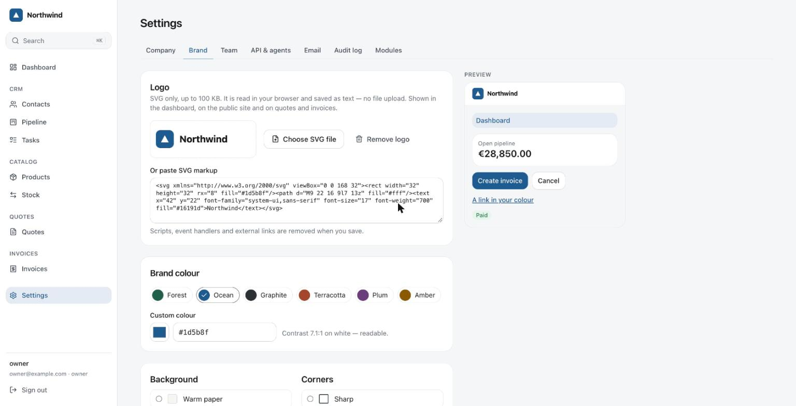

# Sistemėlė

**A small business system you own, running on Cloudflare Workers.**
CRM, products and stock, quotes, invoices, website pages and a blog, a
drag-and-drop dashboard, a fast public website and an MCP endpoint for AI agents — in one Worker and one D1
database. MIT licensed.

*Sistemėlė* is Lithuanian for "a little system".


```text
Browser ─┬─ /            server-rendered public site (SEO, no client JS)
         ├─ /app/*       React dashboard (drag-and-drop, per-user layouts)
         ├─ /api/*       JSON API (sessions or API tokens, roles, audit)
         └─ /mcp         Model Context Protocol for AI agents
                │
        Cloudflare Worker (Hono) ── D1 (SQLite) · Resend (email) · static assets
```

## What you get

| | |
| --- | --- |
| **CRM** | Contacts, drag-and-drop deal pipeline, notes, calls, tasks, website requests that land as leads. |
| **Catalog & stock** | Products and services, stock ledger with receipts, counts and adjustments, low-stock alerts, public product pages with Product structured data. |
| **Quotes** | Numbered quotes with line items and VAT per rate, a private link where the customer accepts or declines, deal moves to Won automatically. |
| **Invoices** | Gap-free numbering, immutable once issued, partial payments, overdue tracking, bank-transfer details, a private invoice link. |
| **Website pages & blog** | An editable home page with the latest posts, pages and posts written in Markdown with a live preview, drafts, scheduling, a site-menu position, RSS and BlogPosting data. Anyone drafts (agents too); owners and admins publish. |
| **Dashboard** | Drag-and-drop cards, KPI metrics from every module, templates (Owner, Sales, Operations, Minimal), layouts saved per user. |
| **Your brand, no code** | Settings → Brand: SVG logo (pasted or picked, no uploads), brand colour presets or any hex with a contrast check, background tone and corner style — applied to the dashboard, public site and documents. Company details in Settings → Company. |
| **AI-native** | Every module exposes MCP tools; `AGENTS.md`, module READMEs and an installable skill tell agents how to extend it; `llms.txt` and Markdown responses for public pages. |
| **Website & SEO** | Server-rendered pages with unique titles, canonical URLs, Open Graph, JSON-LD, sitemap.xml and robots.txt that never indexes previews. |
| **Basics done properly** | Passwordless sign-in, owner/admin/member roles, API tokens, audit log, CSRF protection, security headers, rate limits, email log, tests against a real D1. |



Modules are switched on in `sistemele.config.ts`. They talk through typed
events: an accepted quote wins the deal, an issued invoice deducts stock, a
payment lands on the customer's timeline.

## Quick start

Requirements: Node 22+, a Cloudflare account for deployment (not needed locally).

```bash
npx degit aimantas/sistemele my-business
cd my-business
npm install
npm run setup        # creates .dev.vars, migrates the local D1, loads demo data
npm run dev          # http://localhost:5173 and http://localhost:5173/app
```

Sign in at `/app/login` with `owner@example.com` (or the address you put in
`ADMIN_EMAILS` in `.dev.vars`). Locally, the sign-in link is shown on screen
and printed in the terminal.

## Deploy

```bash
npx wrangler login
npm run setup:cloudflare   # creates the D1 database and applies migrations
npx wrangler secret put RESEND_API_KEY
npm run deploy
```

Set `APP_URL`, `ADMIN_EMAILS` and `EMAIL_FROM` in `wrangler.jsonc` first. Full
guide: [docs/deployment.md](docs/deployment.md).

## Work on it with an AI agent

- Agents read [AGENTS.md](AGENTS.md) (Claude Code reads it through `CLAUDE.md`).
- Install the skill in any agent that supports skills: `npx skills add aimantas/sistemele`.
- Connect an agent to a running installation over MCP: Settings → API & agents. See [docs/ai-agents.md](docs/ai-agents.md).

Useful prompts:

- “Create a bookings module with services, time slots and a public booking form.”
- “Add a dashboard card that shows revenue per month for the last 12 months.”
- “Translate the dashboard to Lithuanian.”

## Documentation

| Guide | |
| --- | --- |
| [Getting started](docs/getting-started.md) | Local setup, demo data, first steps. |
| [Architecture](docs/architecture.md) | Request flow, module system, events, security model. |
| [Modules](docs/modules.md) | Module contract and how to build one. |
| [Dashboard](docs/dashboard.md) | Widgets, metrics, templates, AI customisation recipes. |
| [AI agents](docs/ai-agents.md) | MCP, API tokens, skill, agent workflows. |
| [Deployment](docs/deployment.md) | Cloudflare, D1, secrets, domains, previews, CI. |
| [Email](docs/email.md) | Resend setup, templates, delivery log. |
| [SEO](docs/seo.md) | Public pages, structured data, sitemap, llms.txt. |
| [Security](docs/security.md) | Auth, roles, tokens, CSRF, rate limits. |
| [Testing](docs/testing.md) | Test harness and conventions. |
| [Roadmap](docs/roadmap.md) | What is planned next. |

## License

MIT — see [LICENSE](LICENSE).
